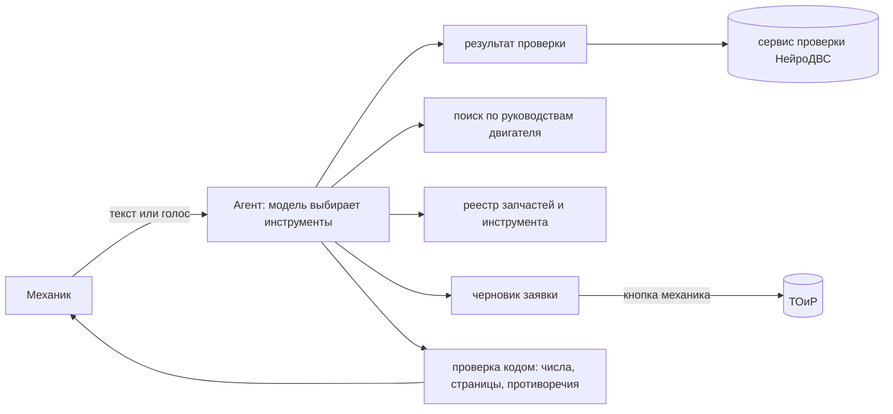

# Цифровой механик

Помощник механика автопарка в браузере — на телефоне и на компьютере. Берёт результат акустической проверки двигателя
(НейроДВС), объясняет его, отвечает на вопросы строго по руководству на двигатель этой машины со ссылкой на страницу и
после подтверждения механика оформляет заявку на дефектовку в ТОиР. Отвечает на языке вопроса — русском, узбекском
(латиница и кириллица), казахском, таджикском, киргизском, английском, хинди; под ответом не по-русски — «Показать
по-русски». Вопрос можно задать голосом (русский, узбекский, казахский, английский), короткий ответ — прослушать.

Хакатон «ИИКузница» (26–28 ноября 2026 года), задача «Цифровой механик», заказчик — ООО «НейроДВС».
Команда Father & Son.

© 2026 Команда Father & Son. Код открыт для жюри, организаторов и заказчика конкурса «ИИКузница» — смотрите, запускайте,
задавайте вопросы. Права на использование — по Положению о конкурсе; сторонние компоненты — по своим лицензиям
([`THIRD_PARTY.md`](THIRD_PARTY.md)). Хотите попробовать у себя или обсудить пилот — напишите нам в Issues этого репозитория.

| | |
|---|---|
| **Стенд** | https://bbab8qkqhuhg3ere9dam.containers.yandexcloud.net/ — без входа; работает до питчей 3 декабря 2026 года, до 15 декабря поднимается по запросу. Версия и состояние — `/health` |
| **Видео** | [2:49, один дубль на стенде](https://disk.yandex.ru/i/1CX2vWZjTDnmmA) |
| **Материалы** | [папка](https://disk.yandex.ru/d/M3HU_3Zl71IfKw): план пилота и стоимость внедрения, независимая приёмка, расчёт стоимости запроса |

Первый запрос после простоя может ждать до 30 с — контейнер просыпается.

## Проверить за 5 минут на стенде

1. **B418HK98** → «Получить результат диагностики»: карточка «клапанный механизм», приоритет и почему — правилами кода,
   без модели. Ссылка «стр.» открывает страницу руководства, строка обведена рамкой.
2. Там же: «Какой зазор клапанов?» (короткий ответ сверху, сноски на страницы) → «Можно ли ехать своим ходом»
   (вердикт и одно действие) → «Создать заявку» → «Отправить в ТОиР» (номер `TKT-…`).
3. Там же: «Регулировать зазоры клапанов на горячем или на холодном двигателе?» — карточка противоречия в руководствах:
   обе формулировки со страницами, безопасное правило, «№ N · у главного механика».
4. **H142OX78**, проверка S-0113 — запись с помехами: диагноза и заявки нет, посторонний текст в данных не исполняется.
   **M260EH47**, проверка S-0079 — «бензин на дизеле»: такого узла у двигателя нет, заявки нет.
5. «Парк» → «Главный механик»: статусы парка, «сначала проверить», реестр заявок, «Противоречия в руководствах».
   Под любым ответом — «Журнал действий»: из каких страниц ответ и сколько он стоил.

Все сценарии подробно — [`docs/details.md`](docs/details.md).

## Три правила, за которые отвечает код, а не модель

1. **Число в ответе — только со страницы.** Код ищет каждое число на странице, на которую ссылается фраза (для таблиц —
   в той же строке). Не нашёл — фраза снимается с пометкой. Нет в руководстве — «в руководстве этого нет» и что сделать.
2. **Только руководства двигателя этой машины.** Поиск сначала отбирает руководства двигателя из карточки, потом
   ранжирует; неисправность, которой у двигателя быть не может, — «такого узла нет», без заявки.
3. **Заявка — только по кнопке механика.** При сбое записи, норме и несовместимой неисправности заявки нет; в остальных
   случаях агент готовит лист, в ТОиР его отправляет кнопка, сервер сверяет, что уходит показанный состав.

Вердикт и срочность, «можно ли ехать своим ходом», противоречия в руководствах — тоже правила кода. Модель выбирает
инструменты (поиск по руководству, страницы, реестр запчастей и инструмента, история, заявка) и формулирует ответ.

## Результаты

| Что | Результат |
|---|---|
| Независимая приёмка на стенде (28.11, версия 4ea1d93): 40 вопросов, половина скрыта от команды | **34 из 40**; скрытая половина **18 из 20**; вопрос о противоречии пройден |
| Набор 48 вопросов, составленных вслепую вторым участником команды | **42 из 48** |
| Ссылки на руководство другого двигателя | **0** |
| Стоимость сценария «проверка → вопрос → заявка» (DeepSeek, без НДС) | **0,14 ₽**; парк 50 машин — 20–25 ₽ в месяц; голос — +0,27 ₽ за вопрос |
| Противоречия в руководствах заказчика | 5 в реестре; агент находит новые в работе и передаёт главному механику |

Отчёт приёмки — [`reports/2026-11-28-final-acceptance.md`](reports/2026-11-28-final-acceptance.md); расчёт стоимости —
[`reports/cost-calculator.xlsx`](reports/cost-calculator.xlsx) и [`reports/cost.md`](reports/cost.md); замеры по ходу
спринта — [`docs/details.md`](docs/details.md).

## Как устроено



Бэкенд — `src/service/` (FastAPI): правила вердикта `verdict_policy.py`, агент и проверка ответа `agent.py`,
противоречия `contradictions.py`, паспорт ответа `passport.py`. Интерфейс — `web/` (React). Знания из руководств —
`data/` (таблица «неисправность × двигатель», реестр запчастей и инструмента, противоречия). Подробно — [`docs/details.md`](docs/details.md).

## Запуск

Нужно: [uv](https://docs.astral.sh/uv/), для интерфейса — Node 24. Материалы задачи (заглушки сервиса проверки и ТОиР,
данные парка) в репозиторий не входят: их скачивает `make fetch-materials` по ссылке `TASK_MATERIALS_URL` из материалов
организаторов.

```sh
git clone https://github.com/ValeriyPronkin/digital-mechanic.git && cd digital-mechanic
cp .env.example .env     # впишите TASK_MATERIALS_URL; для чата — DEEPSEEK_API_KEY
make setup && make fetch-materials
make web                 # один раз: собрать интерфейс механика
make mocks               # терминал 1: заглушки :8001 и :8002
make run                 # терминал 2: http://localhost:8000
```

Или в Docker, интерфейс собирается сам: `make fetch-materials`, затем `docker compose up --build`.

Без `make web` на `/` откроется прежняя упрощённая страница механика — она оставлена запасной и на стенде доступна
по `/v1`. Индекс руководств подключается из частного хранилища (ключ на чтение — в форме сдачи) или собирается из PDF
командой `make index`. Подробно, со всеми проверками и деплоем, — [`docs/dev.md`](docs/dev.md).

## Ограничения

Каждая заглушка в коде помечается `STUB: <id>` и описывается здесь строкой `- <id> — что не сделано`;
`make stubs` падает на неописанной.

- `STUB: parts-catalog` — поставщики запчастей не подключены (по умолчанию и на стенде): наличие, цена и срок не показываются, в черновике и в `parts_offers` — «каталог поставщика не подключён». Подключение — файлами поставщиков `PARTS_SUPPLIERS` (раздел «Подключить поставщика» в `docs/dev.md`; пример — `data/demo/suppliers/`, вымышленные), путь внедрения — учётная система заказчика (1С).
- `STUB: search-until-#3` — если индекс руководств не собран (`make index`) или стенд не скачал его из бакета (`/health` → `manuals_index.present: false`), поиск по руководству пуст: агент отвечает «в руководстве не нашёл», заявка невозможна (нет ссылок).

Что ещё не сделано:

- Сервис проверки НейроДВС и ТОиР — заглушки заказчика по их контракту; рабочие адреса подставляются настройкой.
- Голосом таджикский, киргизский и хинди — нет (у SpeechKit нет этих языков), текстом — да.
- Перечни и таблицы на нескольких страницах и значения на рисунках находятся не всегда. В пилоте — индекс по
  логическим блокам вместо страниц и разовая расшифровка рисунков; цена запроса не меняется.
- У главного механика нет сводки с графиками; паспорт карточки проверки не выводится на экран; в истории обращений нет
  фильтра «по делу / прочие»; входа по ролям нет — режим главного механика включается переключателем.
- На публичном стенде — лимит частоты запросов и лимит расходов на модель.

## Путь к пилоту

Рабочие сервисы проверки и ТОиР — адреса в `.env` (`src/service/clients.py`); новые руководства — PDF и `make index`;
поставщики запчастей — файл настроек на поставщика; модель в российском контуре — `LLM_PROVIDER=gigachat`; голос на
таджикском и киргизском — локальная модель речи; итог дефектовки возвращается как разметка для акустической модели
(`GET /api/v2/outcomes.csv`). План пилота и стоимость внедрения — в [папке материалов](https://disk.yandex.ru/d/M3HU_3Zl71IfKw).

## Из чего собрано и наработки

Модели и API: DeepSeek (`deepseek-chat`) — модель агента; GigaChat — второй провайдер, на стенде не включён;
Yandex Cloud — эмбеддинги и OCR (AI Studio), голос (SpeechKit), Serverless Containers, Object Storage. Модели Anthropic в
работе продукта не используются. Полный список библиотек с лицензиями — [`THIRD_PARTY.md`](THIRD_PARTY.md).

Каркас репозитория (CI, хуки, `Makefile`, Docker, деплой) — из шаблона `ai-forge`, сделанного до хакатона: первый
коммит `27c9ef5`, код продукта — с `fce39d3` (26.11.2026, 12:17 МСК). Интерфейс и второй поиск по документам — из
прототипа второго участника команды, написанного в этот же спринт. Код написан с помощью ассистента разработки Claude Code.

Решения и их причины — [`DECISIONS.md`](DECISIONS.md); состояние проекта — [`STATUS.md`](STATUS.md).
